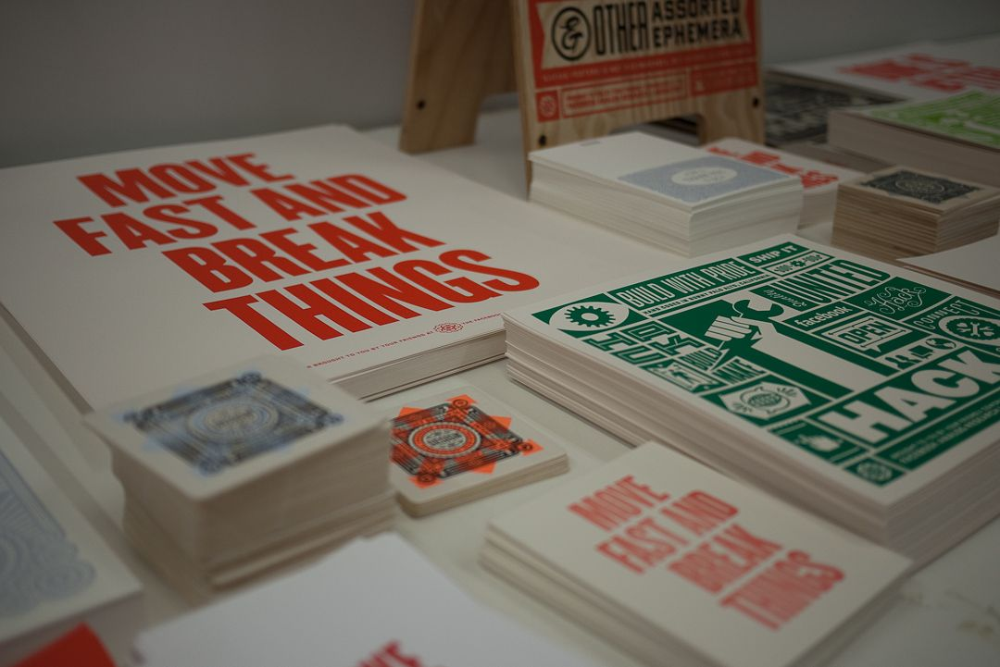

Newsroom product development is a fraught and complex space, under-defined and misunderstood. Yet one thing both editorial and product disciplines share is a love of speed.

In some limited instances the rapid release of information can be vital to keep people safe. However for the lion-share of stories waiting until the dust has settled somewhat clearly leads to a better experience for readers.

Speed is also often lionised as an undeniable good when it comes to product development. I can't imagine many people who work in product haven't heard the phrase "Move Fast and Break Things"

*https://outofoffice.room.com/inside-facebook-analog-research-lab/ - Credit: Facebook*

Although both disciplines seem to value speed, it seems to me to be for all the wrong reasons. Rolling 24 hour news channels and multiple news organisations rushing to send push notifications to the same 200 word news story delivers very little value to readers (and results in a race to the bottom for clicks and eyeballs).

By the same token, rushing out 'minimum viable' product experiences without a clear understanding of what you want or need to learn offers little in the way of value to readers.

It seems speed is not virtuous on its own.    

What is the value of speed then? I think for modern newsrooms trying to create the best possible product experiences what we are actually interested in is **learning quickly** and **making better decisions**.

### Speed ≠ Learning

Being able to release product features quickly is good in theory - lean product development keeps costs down, but most importantly allows you to verify ideas before you over commit. The faster you can put ideas in your readers' hands, the sooner you can learn what they think or see how they behave.

But if you are not clear on what you are trying to learn, or if you can use data you already have as a proxy, or you build 'too small a slice' of the idea you are just wasting time that could be better spent.

That last danger - 'too small a slice' is often the biggest pitfall. In the rush to be lean we do too little and this means you only ever climb small mountains. What I mean by this is; sometimes things are hard and complex - the only way to climb a big mountain is to do it. You can't climb a big mountain by climbing five smaller ones instead.

I think that we shouldn't be optimising teams to deliver small incremental improvements at speed. We should be focused on reducing our **Time To Learn**. How do we structure good experiments? How do we ask better questions? Is what we will learn worth the time spent coding?

I think moving at a consistent '[High average speed](https://jamesclear.com/average-speed)' is much more valuable than constant peaks and troughs.

### Speed & decision making

Lets assume we have fixed our speed problem; that we can develop product ideas both quickly and thoughtfully with a clear understanding of what we need to learn and why.

All this fast learning is no use if we don't have good decision making frameworks to help us make use of what we learn. (No, a steering committee is not a decision making framework)  

Bezos uses his '[Two-way door' framework](https://www.entrepreneur.com/article/328284)

> One way door decisions require *"long and careful consideration..."\[These\] decisions must be made methodically, carefully, slowly, with great deliberation and consultation*

but if a decision can be easily reversed (two way door), just make it and move on, if it it doesn't work, reverse it.

Most business are too risk averse and spend far too long trying to make the 'right' decision and either end up making no decision or taking so long much of the benefit is delayed or the cost is higher. This paralysis of indecision is often worse than making the 'wrong' one (assuming it's a 'door two' style decision).

Being focused on how to build robust Learning Loops and then using what we learn to make better, faster decisions is far more important than speed for the sake of speed.

---

### Further reading

There have been some excellent posts about newsrooms and product this summer that unpack how we could and should be adapting to our readers' needs

-   [Content is Product and Product is Content: why deeper alignment is the only way forward](https://www.linkedin.com/pulse/content-product-why-deeper-alignment-only-way-forward-dmitry-shishkin/) by Dmitry Shishkin
-   [Journalism Has Been Disrupted. Can Product Thinking Save It?](https://knightlab.northwestern.edu/2020/11/09/journalism-disrupted-can-product-thinking-save-it/) by [Meredith Gallo](https://knightlab.northwestern.edu/people/meredith-gallo/)
